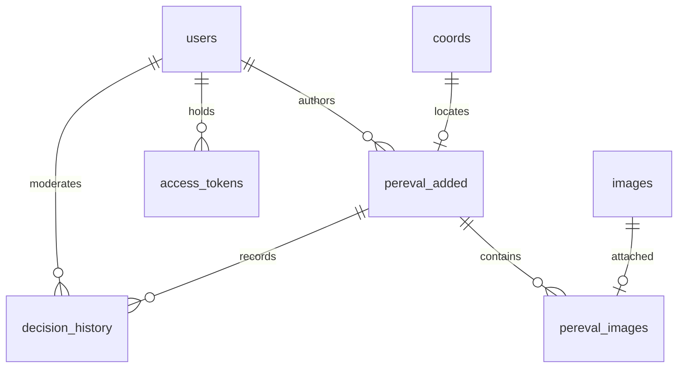
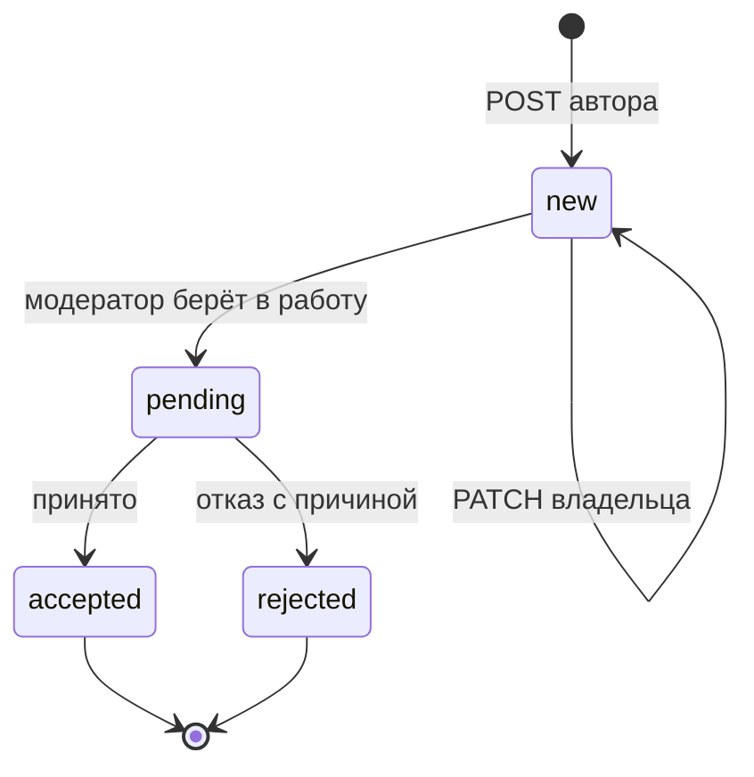

# Pereval API — заявка от автора до решения модератора

Учебный backend для сбора сведений о горных перевалах. Автор отправляет координаты,
сложность и фотографии, исправляет свою новую заявку; модератор берёт её в работу
и принимает либо отклоняет с причиной. Решения сохраняются в истории, после начала
модерации содержимое менять нельзя. Все заявки доступны только с проверкой прав.

Стек: **Python 3.13.9, FastAPI, Pydantic 2, синхронный SQLAlchemy 2 + psycopg2,
PostgreSQL 18, Alembic, pytest, Docker Compose**. Ниже — быстрый локальный запуск
и [сценарий показа на 3–5 минут](docs/DEMO.md). После запуска доступны
[Swagger](http://localhost:8000/docs), [ReDoc](http://localhost:8000/redoc) и
[OpenAPI](http://localhost:8000/openapi.json). Публичного демо-сервера нет.

Это проект виртуальной стажировки, доработанный для портфолио Junior
Python backend. ФСТР упоминается в учебной постановке; реальное сотрудничество,
внедрение и реальные пользователи не заявляются. [Происхождение проекта](docs/DECISIONS.md#происхождение-проекта).

**Состояние:** локальный сценарий воспроизводится; [результаты чистого запуска](docs/VERIFICATION.md).
QA-01 закрыта: зависимости обновлены, [аудит](docs/DEPENDENCIES.md) lock-файлов,
чистого окружения и готового Docker-образа не находит известных уязвимостей.
Удалённый CI не подтверждён.
Проект не представлен как готовый к публичной эксплуатации.

## Быстрый запуск демо

Нужны Git, Python 3.13.9 для вспомогательных команд и запущенный Docker с Linux-контейнерами
и Compose v2. Выполняйте команды в корне свежего checkout. Локальные PostgreSQL и
Python-пакеты для этого способа не нужны: API и миграции работают в контейнерах.
Порт 8000 должен быть свободен; не задавайте параллельно `FSTR_*`/`PORT` в окружении
терминала — они имеют приоритет над env-файлом Compose.

PowerShell, после получения копии репозитория:

```powershell
# Создать отдельные случайные реквизиты, не перезаписывая их при повторе.
if (-not (Test-Path .env.demo)) {
    python -c "import secrets; print('FSTR_DB_NAME=pereval_demo\nFSTR_DB_LOGIN=demo\nFSTR_DB_PASS='+secrets.token_urlsafe(32)+'\nPORT=8000')" | Set-Content -Encoding ascii .env.demo
}
docker compose --env-file .env.demo -p pereval-demo -f docker-compose.yml -f docker-compose.demo.yml up --build -d --wait
docker compose --env-file .env.demo -p pereval-demo -f docker-compose.yml -f docker-compose.demo.yml exec -T app python -m app.demo seed
docker compose --env-file .env.demo -p pereval-demo -f docker-compose.yml -f docker-compose.demo.yml exec -T app python -m app.demo run
```

Ожидайте `tokens_issued: 0` и четыре ID/статуса от seed, затем `DEMO OK` от сценария.
`run` проверяет реальные HTTP-ответы: **создание 201 → PATCH 200 → чужой автор 403 →
модерация → история → запрет PATCH 409**. В конце проверяется и анонимный запрос 401.
Секреты не печатаются. Для рассказа с паузами замените последнюю команду на
`exec app python -m app.demo run --pause` (без `-T`).

Linux/macOS: вместо блока PowerShell создайте env-файл следующей командой;
команды `docker compose` те же. Проверена ветка PowerShell и Linux-контейнеры,
команды оболочки Linux/macOS отдельно не исполнялись.

```sh
test -f .env.demo || python3 -c "import secrets; print('FSTR_DB_NAME=pereval_demo\nFSTR_DB_LOGIN=demo\nFSTR_DB_PASS='+secrets.token_urlsafe(32)+'\nPORT=8000')" > .env.demo
```

Compose ждёт готовности PostgreSQL, выполняет `alembic upgrade head`, затем запускает
API. Порт опубликован только на `127.0.0.1`; порт БД наружу не публикуется.
`/health` — liveness, он не проверяет соединение с БД; работу БД проверяет сценарий.
Диагностика: та же команда Compose с `ps` или `logs app migrate` вместо `up ...`.

Остановка сохраняет демо-данные:

```powershell
docker compose --env-file .env.demo -p pereval-demo -f docker-compose.yml -f docker-compose.demo.yml down
```

Для полного сброса **только этой учебной БД** добавьте `--volumes` к `down`.
Не переиспользуйте имя проекта `pereval-demo` для рабочих данных.

## Что можно показать

| Операция | HTTP | Доступ |
| --- | --- | --- |
| Создать заявку | `POST /submitData/` → 201 | Автор, профиль совпадает с выданной личностью |
| Прочитать заявку | `GET /submitData/{id}` | Владелец или модератор |
| Частично изменить | `PATCH /submitData/{id}` | Только владелец и только `new` |
| Список по email | `GET /submitData/?user__email=...&limit=20&offset=0` | Автор — свой email; модератор — любой |
| Очередь | `GET /moderation/perevals?status=new&limit=20&offset=0` | Модератор |
| Решение | `PATCH /moderation/perevals/{id}/status` | Модератор, с `expected_status` |
| История | `GET /submitData/{id}/history?limit=20&offset=0` | Владелец или модератор |

PATCH сохраняет пропущенные поля; `null` очищает только необязательные строки и
сезоны. Можно изменить одну высоту или один сезон. `images` полностью заменяет
фотографии, `[]` удаляет их. Профиль пользователя, неизвестные поля, пустые PATCH
и вложенные объекты запрещены. Фото — проверенный однокадровый JPEG/PNG в строгом
base64, до записи в БД. Списки возвращают массивы без фото, `id ASC`, лимит 1–100.

[Запросы, ответы и ошибки](docs/DEMO.md#примеры-запросов) ·
[Подробный контракт](docs/API_CONTRACT.md).

## Модель данных и переходы



`pereval_added.coord_id` уникален. `pereval_images` хранит порядок фото, уникальную
пару (заявка, позиция) и уникальный `id_image`: одно фото не разделяется между
заявками. `access_tokens` хранит хеш, роль, срок и отзыв; роль принадлежит токену.
История хранит автора решения, переход, время и причину. Унаследованные справочники
`pereval_areas` и `spr_activities_types` не используются API и опущены на схеме.



Петля `new → new` означает изменение содержимого, не решение модератора.
История начинается с `new → pending`. Обратных переходов, повторного рассмотрения
и удаления заявок через API нет.

## Авторизация и границы демо

HTTP требует `Authorization: Bearer <token>`. Выдача доступна только оператору
через `python -m app.cli issue`; регистрации или назначения ролей по HTTP нет.
Автор не видит чужие заявки/историю. Модератор не создаёт заявки и не правит
содержимое. Некорректный, истёкший или отозванный токен → 401 с
`WWW-Authenticate: Bearer`; чужая заявка или неподходящая роль → 403.

Токены случайные (256 бит), в БД хранится SHA-256. CLI выдаёт секрет один раз,
после commit. По умолчанию TTL 24 часа, допустимы 1–8760; отзыв по `token_id`.
Отзыв проверяется при каждом запросе, но уже авторизованная операция может завершиться.
[Ручная выдача для Swagger](docs/DEMO.md#ручной-доступ-в-swagger).

Демо CLI требует одновременно `FSTR_DEMO_MODE=true` и имя БД с суффиксом `_demo`.
Основной Compose не передаёт demo-флаг; включение — отдельный override-файл.
Seed не запускается при старте приложения или миграциях и **не выдаёт токены**.
Сценарий использует временные токены на час, держит их в памяти и отзывает в
`finally`, в том числе при обычном прерывании. После принудительного убийства процесса
отзыв не гарантирован: действует TTL. Сценарий разрешает только loopback HTTP,
не использует прокси и не следует перенаправлениям.

Это защита от случайного запуска и ограничение учебного доступа, не изоляция от
оператора с паролем БД. Не включайте demo-режим на рабочем окружении и не выдавайте
публичный модераторский токен. `.env.demo` игнорируется Git и не попадает в образ.

## Миграции и запуск без Docker для API

Для API на хосте нужны установленная PostgreSQL, отдельная пустая БД и её реквизиты.
Сначала создайте venv и установите зависимости, как в разделе проверок ниже, затем:

```powershell
Copy-Item .env.example .env
# Заполните FSTR_DB_* своими локальными настройками; не коммитьте .env.
python -m alembic upgrade head
python -m alembic current
python -m alembic check
python -m app.main
```

Не перезаписывайте уже настроенный `.env`. Порядок: настройки → миграции → API.
`python -m app.main` читает `PORT`; для `uvicorn app.main:app --reload` укажите
`--port` самостоятельно. Импорт модулей не подключается к БД и не создаёт таблиц.
Для повторной миграции контейнерного демо:

```powershell
docker compose --env-file .env.demo -p pereval-demo -f docker-compose.yml -f docker-compose.demo.yml exec -T app python -m alembic upgrade head
docker compose --env-file .env.demo -p pereval-demo -f docker-compose.yml -f docker-compose.demo.yml exec -T app python -m alembic check
```

Откат (`python -m alembic downgrade <revision>`) — только на копии с резервной копией
данных: например, откат ниже `0004` удаляет токены и историю. Проверка upgrade/downgrade
на одноразовых БД входит в интеграционные тесты.

## Проверки QA и CI

PowerShell, чистый checkout без `.env` и без пакетов из другого окружения:

```powershell
python -m venv .venv
.\.venv\Scripts\Activate.ps1
python -m pip install -r requirements.txt -r requirements-dev.txt
python -m pip check
python -m ruff check .
python -m pytest -m "not integration"
python -m pytest -m integration tests/integration -v
```

Если политика PowerShell запрещает активацию, запускайте команды через
`.\.venv\Scripts\python.exe` вместо `python`. Linux/macOS: `source .venv/bin/activate`;
для сборки psycopg2 нужны компилятор и libpq headers (Debian/Ubuntu:
`build-essential libpq-dev python3-dev`).

Обычный `pytest` запускает быстрый набор на SQLite. Он проверяет контракт и
валидацию, но не доказывает PostgreSQL-блокировки. Интеграционный набор требует
Docker: сам создаёт контейнер PostgreSQL 18 с новым паролем, новую БД на каждый
тест и удаляет их. Пользовательские `.env` и БД не используются; нет Docker —
ошибка, не успешный skip. Проверяются миграции, SQL-ограничения, rollback,
права, сетевой Uvicorn, конкурентные записи и demo-seed.

Дополнительные обязательные проверки:

```powershell
python -m pytest -o addopts= --strict-config --strict-markers --cov=app --cov-branch --cov-report=term-missing --cov-report=xml:reports/coverage.xml
python scripts/check_compose.py --remove-volume
python scripts/check_secrets.py
New-Item -ItemType Directory -Force reports | Out-Null
python -m pip_audit --disable-pip --no-deps -r requirements.txt -r requirements-dev.txt --format json --output reports/pip-audit.json
```

Аудит зависимостей проходит с кодом 0; при новых находках он должен блокировать
проверку. QA-01 закрыта без исключений advisory. Gitleaks проверяет текущие
Git-файлы и историю; одно точное историческое
исключение описано в [отчёте проверок](docs/VERIFICATION.md). Оно не означает удаления
реквизитов из старых коммитов или ротации. Текущие секреты исключены из Git/образа.

[CI](.github/workflows/ci.yml) содержит пять jobs: быстрый набор, PostgreSQL,
контейнерный smoke, зависимости, секреты. Локальный успех не выдаётся за запуск
GitHub Actions. Версии фиксируются в `requirements*.txt`, исходные наборы —
`requirements*.in`; для согласованного обновления используйте `piptools compile`
с `--upgrade-package <name>` и повторите проверки совместимости.

## Решения и ограничения

[Технические решения](docs/DECISIONS.md): почему sync,
где commit/rollback, как `FOR UPDATE` закрывает гонку, зачем ограничения и миграции.

Нет фронтенда, публичного каталога, полноценного управления аккаунтами, refresh/OAuth,
геопоиска и повторной модерации. Фото хранятся в БД; по умолчанию максимум 5 фото,
5 MiB на фото, 20 MiB суммарно, 24 млн пикселей, сторона до 12000, тело до 32 MiB.
Это границы валидации, а не измеренная пропускная способность. Нагрузочные тесты,
SLA, production deployment и эксплуатационная оценка advisory не выполнены.

Документация: [контракт API](docs/API_CONTRACT.md), [демонстрация](docs/DEMO.md),
[технические решения](docs/DECISIONS.md), [проверки](docs/VERIFICATION.md),
[зависимости и открытые ограничения](docs/DEPENDENCIES.md).
